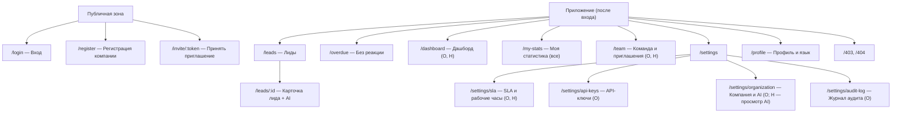
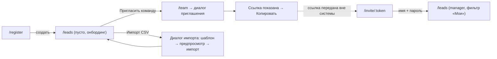
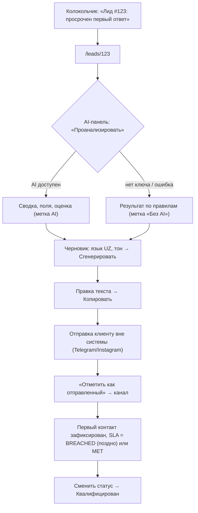
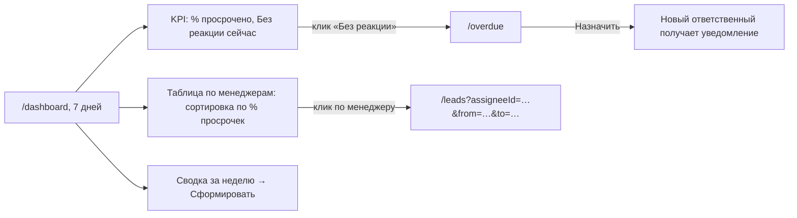
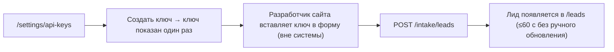

# UX/UI-спецификация: Vippi Leads — демо-MVP

**Версия:** 1.0 · **Дата:** 2026-10-21 · **Статус:** PROPOSED
**Связанные документы:** [PRD](../product/PRD.md) · [SPEC](../technical/SPEC.md) · [design-system](./design-system.md)

---

## 1. UX-принципы

| # | Принцип | Как проверяется |
|---|---|---|
| P1 | **Реакция важнее всего.** Просрочка и «Без реакции» видны с любого экрана (счётчик в меню, колокольчик) | Счётчик в сайдбаре на всех страницах |
| P2 | **Честный AI.** Результат правил никогда не выглядит как AI (UX-4) | AC-039 |
| P3 | **Человек решает.** AI-тексты — только черновики; ничего не отправляется автоматически | AC-044 |
| P4 | **Цвет + текст.** Статус и SLA передаются цветом и словом/иконкой (UX-3) | axe + ревью |
| P5 | **Быстрый путь менеджера** ≤5 кликов: открыть лид → черновик → копировать → отметить отправленным (UX-5) | e2e-сценарий S-4 |
| P6 | **Два языка равноправны.** Узбекский текст не длиннее, чем помещается: вёрстка выдерживает +30% длины строки | Визуальная проверка на `uz` |

## 2. Информационная архитектура

### 2.1. Карта сайта

### 2.2. Маршруты и доступ
| Маршрут | owner | head_of_sales | manager | Стартовая страница после входа |
|---|---|---|---|---|
| `/dashboard` | ✓ | ✓ | 403 | owner, head_of_sales |
| `/my-stats` | ✓ | ✓ | ✓ (только свои показатели) | — |
| `/leads`, `/leads/:id` | ✓ | ✓ | ✓ (видимость FR-018) | manager (фильтр «Мои» включён) |
| `/overdue` | ✓ | ✓ | ✓ | — |
| `/team` | ✓ | ✓ (только приглашение менеджеров) | 403 | — |
| `/settings/sla` | ✓ | ✓ | 403 | — |
| `/settings/api-keys`, `/settings/audit-log` | ✓ | 403 | 403 | — |
| `/settings/organization` | ✓ | только просмотр блока AI (FR-075) | 403 | — |
| `/profile` | ✓ | ✓ | ✓ | — |

Неавторизованный пользователь на защищённом маршруте → `/login?next=<маршрут>`.

## 3. Навигация

- **Десктоп (≥1024 px):** левый сайдбар 240 px (сворачивается до 64 px, состояние в Zustand): логотип/название организации; пункты «Дашборд» (O, H), «Моя статистика» (M — роли без дашборда; O и H открывают её из полосы KPI над «Мои лиды»), «Лиды», «Без реакции» (бейдж-счётчик, красный при >0), «Команда» (O, H), «Настройки» (O, H). Внизу — профиль, язык RU/UZ.
- **Топбар:** заголовок страницы, глобальный поиск по лидам (переход в `/leads?q=`), колокольчик уведомлений, кнопка «+ Лид».
- **Планшет (768–1023):** сайдбар свёрнут до иконок с подсказками.
- **Мобильный (<768):** нижняя панель из 4 пунктов: «Лиды», «Без реакции», «Уведомления», «Ещё» (лист с остальными пунктами).
- **Демо-баннер** (FR-096): полоса над топбаром, янтарный фон, текст «Демо-данные: все заявки и люди вымышлены», без кнопки закрытия.

## 4. Общие состояния экранов

Каждый экран реализует применимые состояния (UX-2). Шаблоны:

| Состояние | Паттерн | Компонент |
|---|---|---|
| Загрузка | Скелетоны формы контента (строки таблицы, карточки KPI); без спиннера на весь экран; появление скелетона через 200 мс | `Skeleton` |
| Пусто | Иллюстрация-иконка, заголовок, 1 строка пояснения, основное действие | `EmptyState` |
| Пусто после фильтра | «Ничего не найдено» + «Сбросить фильтры» | `EmptyState` |
| Ошибка загрузки | Сообщение по коду ошибки + «Повторить»; данные, загруженные ранее, остаются видимыми | `ErrorState` / `Alert` |
| Нет доступа | Экран 403: «У вас нет доступа к этому разделу» + «На главную» | `ForbiddenPage` |
| Не найдено | Экран 404 (в т.ч. чужой лид) | `NotFoundPage` |
| Валидация | Ошибка под полем (красный текст + `aria-invalid`), фокус на первом ошибочном поле; серверные `details` мапятся на поля | `FormMessage` |
| Сохранение | Кнопка заблокирована, спиннер в кнопке, текст «Сохранение…»; повторная отправка невозможна | `Button` (loading) |
| Успех | Toast 4 с («Сохранено»), без модальных окон | `Toast` (sonner) |
| Повтор | Ошибки сети при изменении → toast с действием «Повторить» | `Toast` |
| Разрушительное действие | Диалог подтверждения: что произойдёт, необратимость, кнопка с глаголом действия красного цвета; Enter не подтверждает по умолчанию | `AlertDialog` |
| Сессия истекла | Редирект на `/login` с сообщением «Сессия истекла, войдите снова» | — |

## 5. Экраны

**Опциональные элементы (CONFIRMED cut-line, порядок снятия):** (1) экран «Журнал аудита» §5.12; (2) карточка «Сводка за неделю» §5.7; (3) блок рабочих часов в §5.9; (4) график по дням §5.7; (5) шаг предпросмотра в диалоге импорта CSV §5.4 (импорт сразу с итоговым отчётом об ошибках); (6) оценка вероятности сделки в AI-панели §5.5. При снятии элемент удаляется из UI целиком — без заглушек «скоро будет». Остальные элементы обязательны.

**Позиционирование в интерфейсе (CONFIRMED, ADR-004):** онбординг и пустые состояния предлагают оба пути — «Подключить сайт или CRM (API-ключ / импорт CSV)» для компаний с CRM и «Добавить лид вручную / пригласить менеджеров» для компаний без CRM. В UI нет терминов воронки и сделок CRM (этапы, задачи, контакты).

### 5.0. Главная (лендинг) — `/`
- **Доступ:** публичная страница, без входа; `/auth/me` запрашивается без редиректа на `/login` при 401.
- **Содержимое:** шапка (логотип, переключатель RU/UZ, действия), первый экран (заголовок, подзаголовок, схематичный список лидов со статусами SLA «Просрочен на 12 мин» / «Осталось 3 мин» / «Ответ за 4 мин» — декоративный, `aria-hidden`), четыре возможности (таймер первого ответа, уведомления, AI-помощник, дашборд), три шага начала работы, финальный призыв к действию, подвал. Без выдуманных клиентов, отзывов и цифр.
- **Действия гостя:** «Войти» → `/login`, «Зарегистрировать компанию» → `/register`.
- **Действия после входа:** вместо входа/регистрации — «Открыть дашборд» (есть право `dashboard.read`) или «Мои лиды» (менеджер → `/leads?assigneeId=me`) и строка «Вы вошли как {имя} · {компания}».
- **Состояния:** пока сессия загружается — скелетон на месте кнопок. Логотип на экранах входа и регистрации ведёт на `/`.
- **Мобильный:** одна колонка; переключатель языка переносится из шапки под кнопки первого экрана.

### 5.1. Вход — `/login` (FR-002)
- **Содержимое:** логотип, переключатель RU/UZ, поля email и пароль (показать/скрыть), «Войти», ссылка «Зарегистрировать компанию». Под формой в демо-сборке — подсказка «Демо-доступ: см. README».
- **Состояния:** валидация (пустые поля, формат email); сохранение (кнопка «Вход…»); ошибка 401 — общий текст над формой «Неверный email или пароль»; 429 — «Слишком много попыток. Повторите через N мин»; сеть — «Нет соединения» + повтор.
- **Мобильный:** одна колонка, ширина формы 100% − 32 px.

### 5.2. Регистрация компании — `/register` (FR-001)
- **Поля:** название компании, ваше имя, email, пароль (индикатор «минимум 10 символов»), язык интерфейса.
- **Действие:** «Создать компанию» → `/leads` с пустым состоянием-онбордингом: вопрос «Где сейчас живут ваши заявки?» и два пути — «У нас есть CRM» (карточки «Подключить сайт/CRM через API-ключ», «Импортировать выгрузку CSV»; подпись «Нативная интеграция amoCRM/Bitrix24 — в планах») и «CRM нет» (карточки «Добавить первый лид», «Пригласить команду»). Выбор не сохраняется и ничего не ограничивает — это только подсказка.
- **Состояния:** валидация; 409 `EMAIL_TAKEN` — ошибка у поля email со ссылкой «Войти»; сохранение.

### 5.3. Принятие приглашения — `/invite/:token` (FR-006)
- **Содержимое:** «Вас пригласили в {организация} как {роль}»; поля имя и пароль; «Присоединиться».
- **Состояния:** загрузка превью (скелетон); недействительное приглашение (410) — экран без формы: «Приглашение недействительно или истекло. Попросите владельца отправить новое»; 409 — «Этот email уже зарегистрирован»; валидация; сохранение.

### 5.4. Лиды — `/leads` (FR-017, FR-018, FR-010, FR-061)
- **Шапка:** заголовок + счётчик; кнопки «+ Лид» (все), «Импорт CSV» (O, H), «Экспорт CSV» (все; выгружает текущую выборку с фильтрами, FR-064; во время подготовки — кнопка заблокирована с текстом «Экспорт…», ошибка 422 `EXPORT_TOO_LARGE` — toast «Слишком много строк, сузьте фильтры»).
- **Полоса «Моя статистика за 7 дней» (FR-056):** при фильтре `assigneeId=me` над панелью фильтров — получено, медиана первого ответа, % в SLA, конверсия, под каждым «Среднее по команде: X»; ссылка «Подробнее» → `/my-stats`. Пока грузится — скелетоны значений; при ошибке полоса скрывается, список работает.
- **Панель фильтров:** быстрые чипы «Мои» (M — включён по умолчанию), «Не назначены», «Просрочены»; поиск; мультиселекты статус, источник, ответственный (O, H), SLA; период (пресеты + календарь); «Сбросить». Всё синхронизируется с URL.
- **Таблица (десктоп):** № · Клиент (имя + телефон) · Источник (иконка + текст) · Сообщение (превью 1 строка) · Статус (бейдж) · SLA (бейдж + таймер «осталось 7 мин» / «просрочено на 1 ч 05 мин» / «ответ за 4 мин») · Ответственный · Получен (дата/время). Метки «Возможный дубль», «Забыт». Клик по строке → карточка. Сортировка по «Получен» и «Дедлайн».
- **Мобильный:** карточки-строки: имя, бейджи статуса и SLA с таймером, источник, время.
- **Диалог «Новый лид»:** поля FR-010, телефон с маской-подсказкой `+998 __ ___ __ __`; при дубле после сохранения — toast «Создан. Возможный дубль лида #123» со ссылкой.
- **Диалог «Импорт CSV»:** шаг 1 — «Скачать шаблон», зона загрузки (drag & drop + кнопка), ограничения (≤5 МБ, ≤5000 строк, UTF-8); шаг 2 — предпросмотр: сводка (всего/валидных/с ошибками/дублей), таблица 20 строк, список ошибок «Строка 14, колонка phone: неверный формат»; кнопка «Импортировать N строк»; шаг 3 — итог.
- **Состояния:** загрузка (8 строк-скелетонов); пусто — для owner/H: «Пока нет лидов» + «Добавить» / «Импорт CSV» / «Подключить сайт (API-ключ)»; для M: «У вас пока нет лидов. Новые заявки появятся здесь»; пусто после фильтра; ошибка + повтор; импорт — ошибки файла (413/415/400) на шаге 1, сохранение на шаге 2 (прогресс «Импорт…», закрыть диалог нельзя).

### 5.5. Карточка лида — `/leads/:id` (FR-021, FR-013–FR-016, FR-070–FR-073)
- **Раскладка десктоп:** 2 колонки — слева (≈60%) шапка, данные и история; справа (≈40%) AI-панель (липкая).
- **Шапка (`lead-header`):** «Лид #123 · {имя}», бейдж статуса, крупный SLA-блок: обратный отсчёт до дедлайна (обновление раз в 30 с, «Скоро просрочка» — янтарный), «Просрочено на N» — красный, «Ответ за N мин» — зелёный, «Без SLA» — серый (EXEMPT). Кнопки по правам: основная — «Отметить первый контакт» (пока нет контакта), иначе «Сменить статус»; «Назначить» / «Взять себе»; меню «…» — «Редактировать», «Удалить» (O).
- **Диалог первого контакта:** канал (радиокнопки с иконками), комментарий (необязательный), «Сохранить». Подсказка (честное ограничение MVP, ADR-017): «Отметьте сразу после ответа клиенту — время фиксируется в момент нажатия и не меняется».
- **Диалог смены статуса:** только разрешённые переходы; для LOST — причина (обязательна), комментарий для «Другое».
- **Данные:** телефон (кнопка копирования, ссылка `tel:`), источник и детали, текст обращения (полностью, `whitespace-pre-wrap`), бюджет, район, тип, комнаты, дубль-ссылка.
- **История (`lead-timeline`):** форма комментария сверху (textarea, счётчик 0/2000, Ctrl+Enter — отправить), лента событий с иконками по типу, автор/«Система», время.
- **AI-панель (`lead-ai-panel`):**
  - Шапка: «AI-помощник» и строка режима: «AI · Gemini/{модель}» или «Работает без AI — по правилам» (иконка «линейка», серый) + причина (подсказка).
  - Блок «Анализ»: кнопка «Проанализировать» → сводка, язык обращения, извлечённые поля с кнопками «Применить» (и «Применить все»), оценка 0–100 с полосой и меткой «Горячий/Тёплый/Холодный», причины, «Что уточнить». Подпись «Оценка — подсказка, а не прогноз». «Обновить» (с учётом кэша), время генерации, метка «из кэша».
  - Блок «Черновик ответа»: язык RU/UZ (сегмент-контрол, по умолчанию — язык обращения), тон «Официальный/Дружелюбный», «Сгенерировать», редактируемое поле, баннер «Проверьте перед отправкой. Система ничего не отправляет клиенту», кнопки «Копировать» и «Отметить как отправленный» (диалог выбора канала).
  - Подсказка при выключенном AI в организации (owner видит ссылку «Включить в настройках»).
- **Мобильный:** одна колонка; AI-панель — вкладка «AI» рядом с «Детали» и «История»; основная кнопка закреплена внизу экрана.
- **Состояния:** загрузка (скелетоны шапки, полей, ленты); 404 — «Лид не найден или недоступен»; ошибка; AI-генерация — скелетон блока + текст «Анализируем… до 15 секунд», кнопка блокирована; AI-fallback — пометка вместо ошибки; сохранение статуса — оптимистичное обновление бейджа с откатом и toast при ошибке; 422 (переход запрещён / контакт уже отмечен) — toast + обновление данных; удаление — `AlertDialog` «Удалить лид #123? Он исчезнет из списков и отчётов».

### 5.6. Без реакции — `/overdue` (FR-034)
- **Содержимое:** пояснение «Лиды без первого контакта после дедлайна SLA ({N} мин)»; таблица: № · Клиент · Источник · Ответственный · Просрочено на (красный, сортировка по умолчанию) · Получен · действия «Взять себе» (M) / «Назначить» (O, H, выпадающий список участников) / «Открыть».
- **Состояния:** загрузка; пусто — позитивное: «Все лиды получили ответ вовремя» (зелёная иконка); ошибка; назначение — сохранение в строке, toast, строка остаётся до обновления (лид всё ещё без контакта).

### 5.7. Дашборд — `/dashboard` (FR-050–FR-055, FR-074)
- **Шапка:** выбор периода (Сегодня / 7 дней / 30 дней / Период), подпись «Время — Ташкент (UTC+5)».
- **Ряд KPI (8 карточек):** Всего лидов · Медиана первого ответа · В SLA, % · Просрочено, % · Без реакции сейчас (красный акцент, клик → `/overdue`) · Забытые · Потеряны (% ) · Выиграно (конверсия). Каждая карточка — значение, подпись, подсказка «как считается» (иконка `info`, текст определения из FR-051).
- **Таблица по менеджерам** (сортируемая, клик → список лидов), **таблица по источникам**, **график по дням** (столбцы: лиды; линия/столбцы: просрочено).
- **Карточка «Сводка за неделю»:** кнопка «Сформировать», список пунктов, метка AI/«по правилам», время генерации.
- **Состояния:** загрузка (скелетоны карточек и таблиц); пустой период — нули, «—» для медианы, «Нет данных за период» в таблицах и графике; ошибка + повтор; 403 для manager; сводка — генерация (скелетон, ≤15 с), fallback-метка.

### 5.7.1. Моя статистика — `/my-stats` (FR-056)
- **Шапка:** «Моя статистика», подпись «Только лиды, где вы ответственный. Время — Ташкент (UTC+5)», переключатель периода (сегмент-контрол Сегодня / 7 дней / 30 дней, по умолчанию 7 дней).
- **KPI (8 карточек):** Получено · В работе · Закрыто · Сделки · Медиана первого ответа · Ответ вовремя, % · Просрочено · Конверсия в сделку. В карточке — значение, подсказка «как считается» (`info`) и строка «Среднее по команде: X»; для метрик с направлением (медиана, % в SLA, просрочки, сделки, конверсия) строка зелёная, если лучше среднего, и красная, если хуже; для экранных чтецов — текст «лучше/хуже среднего по команде».
- **Пояснение под KPI:** «Среднее по команде — на одного менеджера за тот же период. Имена и личные показатели коллег не показываются». Если в команде меньше 3 человек, сравнение скрыто, вместо пояснения — «Сравнение с командой появится, когда в ней будет от 3 менеджеров».
- **График «Динамика по дням»:** столбцы — мои лиды и мои просрочки, пунктирная линия — среднее по команде лидов на человека.
- **Состояния:** загрузка (скелетоны карточек); пустой период — нули, «—» для медианы и долей, «У вас нет лидов за выбранный период» вместо графика; ошибка + повтор (при смене периода прежние данные остаются).

### 5.8. Команда — `/team` (FR-005–FR-008)
- **Вкладка «Участники»:** таблица имя, email, роль, статус, дата. Действия owner: «Сменить роль» (select с подтверждением), «Деактивировать» (`AlertDialog`: «{Имя} потеряет доступ, его открытые лиды ({N}) станут неназначенными»). Для своей строки действий нет.
- **Вкладка «Приглашения»:** кнопка «Пригласить» → диалог email + роль (для H — только «Менеджер») → экран результата со ссылкой, кнопкой «Копировать» и предупреждением «Ссылка показывается один раз, действует 7 дней». Таблица ожидающих: email, роль, пригласил, истекает, «Отозвать» (подтверждение).
- **Состояния:** загрузка; пусто приглашений — «Нет ожидающих приглашений»; 409 — ошибка у поля email; сохранение; ошибка.

### 5.9. Настройки → SLA — `/settings/sla` (FR-030, FR-031)
- **Поля:** «Время на первый ответ, мин» (число 1–1440, подсказки-чипы 5/15/30/60); «Считать заявку забытой через, ч» (1–168); переключатель «Учитывать рабочие часы»; при включении — дни недели (чекбоксы-кнопки), начало/конец (select с шагом 15 мин). Пример-превью: «Заявка в пятницу 20:00 → дедлайн пн 09:15».
- Пояснение: «Изменения применяются к новым лидам».
- **Состояния:** загрузка; валидация (диапазоны, начало < конца, хотя бы один день); сохранение; успех (toast); 403 для M.

### 5.10. Настройки → API-ключи — `/settings/api-keys` (FR-062)
- **Содержимое:** пояснение и пример запроса `curl` для intake (копируемый блок); таблица ключей (название, префикс `vpk_ab12cd34…`, создан, кем, последнее использование, «Отозвать»); кнопка «Создать ключ» (неактивна при 5 активных с подсказкой).
- **Создание:** диалог с названием → экран с ключом, «Копировать», предупреждение «Ключ показывается один раз».
- **Состояния:** загрузка; пусто — «Ключей нет. Создайте ключ, чтобы принимать заявки с сайта»; отзыв — `AlertDialog` «Запросы с этим ключом перестанут приниматься»; 422 лимит; ошибка.

### 5.11. Настройки → Компания и AI — `/settings/organization` (FR-009, FR-075)
- **Блок «Компания»** (O): название, таймзона (только чтение: Asia/Tashkent).
- **Блок «AI»:** режим («AI · Gemini/{модель}» или «Ключ Gemini не настроен — работает режим по правилам»); в MVP провайдер один — Google Gemini (CONFIRMED, ADR-010), выбора провайдера в UI нет; переключатель «Внешняя AI-обработка» (O) — при включении `AlertDialog`: «Тексты заявок будут передаваться в Google Gemini за пределы Узбекистана. Используйте только после юридической проверки и при наличии правового основания»; использование за сегодня: запросов N / лимит, токенов N / лимит. Для H — только просмотр.
- **Состояния:** загрузка; сохранение; ошибка; 403.

### 5.12. Журнал аудита — `/settings/audit-log` (FR-091)
- Таблица: время, участник/«API-ключ {название}»/«Система», действие (переведённое название), объект, IP; фильтры: действие, участник, период; пагинация 50; детали `metadata` в раскрывающейся строке.
- **Состояния:** загрузка; пусто; пусто после фильтра; ошибка; 403.

### 5.13. Профиль — `/profile` (FR-004, FR-080)
- Имя, email (только чтение), роль (только чтение), язык (RU / Oʻzbekcha), смена пароля (текущий, новый, повтор).
- **Состояния:** валидация (несовпадение паролей, длина); 401 при неверном текущем пароле — ошибка у поля; сохранение; успех «Пароль изменён. Другие сеансы завершены».

### 5.14. Уведомления (поповер в топбаре) (FR-041)
- Список до 50: иконка типа, текст («Лид #123: просрочен ответ на 15 мин», «Вам назначен лид #124»), время относительно («5 мин назад»), точка непрочитанного; «Прочитать все». На мобильном — полноэкранный лист.
- **Состояния:** загрузка; пусто «Новых уведомлений нет»; ошибка (тихий повтор, иконка предупреждения на колокольчике).

## 6. Адаптивность

| Брейкпоинт | Ширина | Поддержка |
|---|---|---|
| `sm` | 360–767 | Сценарии менеджера: список лидов (карточки), карточка лида (вкладки), первый контакт, черновик, уведомления, «Без реакции». Дашборд — KPI в 1 колонку, таблицы с горизонтальной прокруткой (работоспособно, не оптимизировано) |
| `md` | 768–1023 | Всё; сайдбар иконками; таблицы с приоритетными колонками |
| `lg` | 1024–1279 | Всё |
| `xl` | ≥1280 | Основной дизайн (desktop-first) |

Правила: минимальная зона касания 44×44 px на `sm`/`md`; нет горизонтальной прокрутки страницы на 360 px (только внутри таблиц); диалоги на `sm` — полноэкранные листы.

## 7. Доступность (NFR-009, WCAG 2.1 AA)

- Вся функциональность доступна с клавиатуры; порядок фокуса логичен; видимый фокус (кольцо 2 px акцентного цвета, контраст ≥3:1).
- Ссылка «Перейти к содержимому» первой в порядке фокуса.
- Контраст текста ≥4,5:1, крупного текста и иконок ≥3:1 (токены design-system проверены).
- Все поля имеют `<label>`; ошибки связаны через `aria-describedby`; `aria-invalid` на ошибочных полях.
- Таймер SLA: визуально обновляется каждые 30 с, но `aria-live` не используется для каждого тика; при переходе в «просрочено» — однократное объявление `aria-live="polite"`.
- Toast-уведомления — `role="status"`; ошибки — `role="alert"`.
- Диалоги (Radix) удерживают фокус и возвращают его на кнопку-инициатор; `Esc` закрывает (кроме шага импорта «Импорт…»).
- Иконки без текста имеют `aria-label`; декоративные — `aria-hidden`.
- Таблицы — семантические `<table>` с `<th scope>`; сортировка — `aria-sort`.
- `lang` у `<html>` меняется на `ru`/`uz` при переключении языка.
- Уважение `prefers-reduced-motion`: без анимаций скелетонов и переходов.

## 8. Тексты RU/UZ

### 8.1. Правила
1. Узбекский — латиница по действующему алфавиту: **oʻ, gʻ** пишутся с U+02BB (ʻ), разделительный знак (tutuq belgisi) — U+02BC (ʼ), например «maʼlumot». Обычный апостроф `'` в текстах интерфейса не используется; поиск нормализует все варианты (FR-017).
2. Обращение на «Siz» (вежливое), в русском — на «вы» (со строчной).
3. Кнопки — глаголы действия: «Сохранить» / «Saqlash», не «ОК».
4. Ошибки: что случилось + что сделать. Без технических кодов и без обвинения пользователя.
5. Длительности: «12 мин», «3 ч 20 мин» / «12 daq», «3 soat 20 daq». Даты — `ДД.ММ.ГГГГ ЧЧ:мм`.
6. Плюрализация — через i18next (RU: one/few/many; UZ: формы не меняются по числу — «5 ta lid»).
7. Термины фиксированы глоссарием (8.2); «лид» используется как основной термин в интерфейсе на обоих языках.
8. Все UZ-строки — PROPOSED до вычитки носителем языка (TBD-5).

### 8.2. Глоссарий и примеры строк
| Ключ | RU | UZ (латиница) |
|---|---|---|
| `nav.leads` | Лиды | Lidlar |
| `nav.overdue` | Без реакции | Javobsiz |
| `nav.dashboard` | Дашборд | Boshqaruv paneli |
| `nav.myStats` | Моя статистика | Mening statistikam |
| `nav.team` | Команда | Jamoa |
| `nav.settings` | Настройки | Sozlamalar |
| `auth.login` | Войти | Kirish |
| `auth.email` | Электронная почта | Elektron pochta |
| `auth.password` | Пароль | Parol |
| `auth.registerCompany` | Зарегистрировать компанию | Kompaniyani roʻyxatdan oʻtkazish |
| `auth.invalidCredentials` | Неверный email или пароль | Elektron pochta yoki parol notoʻgʻri |
| `lead.status.NEW` | Новый | Yangi |
| `lead.status.CONTACTED` | Связались | Bogʻlanildi |
| `lead.status.QUALIFIED` | Квалифицирован | Saralangan |
| `lead.status.WON` | Сделка | Bitim tuzildi |
| `lead.status.LOST` | Потерян | Yoʻqotilgan |
| `sla.met` | Ответ за {{duration}} | {{duration}} ichida javob berildi |
| `sla.dueIn` | Осталось {{duration}} | {{duration}} qoldi |
| `sla.breached` | Просрочено на {{duration}} | {{duration}} kechikdi |
| `sla.dueSoon` | Скоро просрочка | Muddat tugayapti |
| `lead.recordFirstContact` | Отметить первый контакт | Birinchi aloqani belgilash |
| `lead.assignee` | Ответственный | Masʼul |
| `lead.takeMine` | Взять себе | Oʻzimga olish |
| `lead.possibleDuplicate` | Возможный дубль | Ehtimoliy takror |
| `ai.analyze` | Проанализировать | Tahlil qilish |
| `ai.mode.ai` | AI · {{provider}}/{{model}} | AI · {{provider}}/{{model}} |
| `ai.mode.rules` | Без AI · по правилам | AIsiz · qoidalar asosida |
| `ai.draftWarning` | Проверьте перед отправкой. Система ничего не отправляет клиенту | Yuborishdan oldin tekshiring. Tizim mijozga hech narsa yubormaydi |
| `ai.scoreDisclaimer` | Оценка — подсказка, а не прогноз | Baho — maslahat, bashorat emas |
| `ai.markSent` | Отметить как отправленный | Yuborilgan deb belgilash |
| `common.save` | Сохранить | Saqlash |
| `common.cancel` | Отмена | Bekor qilish |
| `common.delete` | Удалить | Oʻchirish |
| `common.retry` | Повторить | Qayta urinish |
| `common.copy` | Копировать | Nusxa olish |
| `state.empty.leads` | Пока нет лидов | Hozircha lidlar yoʻq |
| `state.error.generic` | Не удалось загрузить данные. Проверьте соединение и повторите | Maʼlumotlarni yuklab boʻlmadi. Ulanishni tekshirib, qayta urinib koʻring |
| `state.forbidden` | У вас нет доступа к этому разделу | Sizda bu boʻlimga kirish huquqi yoʻq |
| `overdue.allGood` | Все лиды получили ответ вовремя | Barcha lidlarga oʻz vaqtida javob berilgan |
| `notif.slaBreached` | Лид #{{number}}: просрочен первый ответ | Lid #{{number}}: birinchi javob muddati oʻtdi |
| `notif.assigned` | Вам назначен лид #{{number}} | Sizga #{{number}} lid biriktirildi |
| `demo.banner` | Демо-данные: все заявки и люди вымышлены | Demo maʼlumotlar: barcha murojaatlar va shaxslar toʻqima |
| `money.uzs` | {{amount}} сум | {{amount}} soʻm |

## 9. Пользовательские потоки

### 9.1. Запуск компании (S-1)

### 9.2. Менеджер реагирует на просрочку (S-3, S-4)

### 9.3. РОП разбирает потери (S-5)

Сценарий показа демо и реплики ведущего — PRD §13.1.

### 9.4. Подключение сайта или CRM (S-2, подсегмент «с CRM»)

Список лидов обновляется при фокусе вкладки и раз в 60 с (`refetchInterval`), чтобы новые лиды из API появлялись без ручного обновления.
